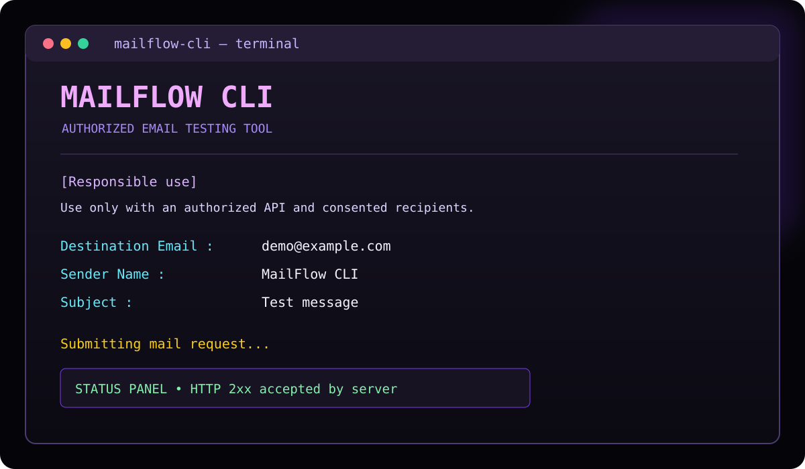
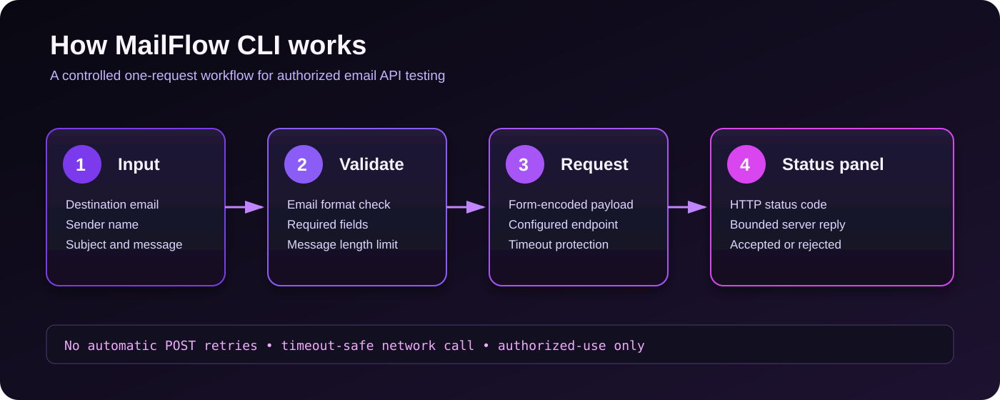

<p align="center">
  
</p>

<h1 align="center">MailFlow CLI</h1>

<p align="center">
  A clean Python command-line client for one authorized email API request.
</p>

<p align="center">
  <a href="https://github.com/darkvibez456/mailflow-cli"><strong>GitHub: darkvibez456/mailflow-cli</strong></a>
</p>

<p align="center">
  
</p>

> **Responsible use:** MailFlow CLI is an educational project. Use it only with an email service you are authorized to access and only for recipients who have consented to receive your messages. Do not use it for spam, harassment, impersonation, credential collection, or bypassing provider controls.

## What is MailFlow CLI?

MailFlow CLI is an interactive terminal program written in Python. It collects four values from the user—destination email, sender name, subject, and message—then sends one form-encoded request to a configured email API.

The tool is designed to make a basic email API integration easy to understand. It does not operate an SMTP server, store a mailbox, scrape addresses, or send bulk campaigns. The external email provider is responsible for authentication, acceptance, delivery, bounce handling, and provider-side logs.

## What is included?

- A Rich-powered terminal interface with MailFlow CLI branding
- Destination email format validation
- Empty-field validation
- A 10,000-character message limit
- Configurable API endpoint and timeout
- Network timeout and request error handling
- HTTP status and bounded server-response display
- No automatic retry of `POST` requests, reducing accidental duplicate submissions
- Termux, Linux, and Windows setup instructions
- Local SVG banner, startup preview, and workflow diagram for the GitHub page

## How does it work?

The program follows a short, predictable flow:

1. It displays the MailFlow CLI banner and responsible-use notice.
2. It asks for the destination email, sender display name, subject, and message.
3. It checks that required fields are not empty and that the destination resembles a valid email address.
4. It builds a form payload with `to`, `from`, `subject`, and `message`.
5. It sends one `POST` request to the configured API endpoint with a finite timeout.
6. It displays the HTTP status, a shortened server reply, and whether the request was accepted or rejected.

<p align="center">
  
</p>

## Request payload

The request sent by the program contains these fields:

```text
to       Destination email address
from     Sender display name or provider-approved sender value
subject  Message subject
message  Message body
```

The request uses `application/x-www-form-urlencoded`, which is compatible with APIs that expect standard HTML-form data. The API endpoint must be authorized and must document support for this format.

A successful HTTP `2xx` response means the API accepted the request. It does not independently guarantee inbox delivery. Delivery, bounces, filtering, and provider-side authentication remain the responsibility of the email service.

## GitHub repository

This project is configured for the GitHub user [`darkvibez456`](https://github.com/darkvibez456):

```bash
git clone https://github.com/darkvibez456/mailflow-cli.git
cd mailflow-cli
```

If your copy of the repository uses another name, replace `mailflow-cli` in the commands with that repository name.

---

## Termux / Android

Install Termux from a trusted source such as [F-Droid](https://f-droid.org/packages/com.termux/) or the official Termux project. Then run:

```bash
pkg update -y && pkg upgrade -y
pkg install -y git python

git clone https://github.com/darkvibez456/mailflow-cli.git
cd mailflow-cli

python -m venv .venv
source .venv/bin/activate
python -m pip install --upgrade pip
python -m pip install -r requirements.txt

python mailflow_cli.py
```

If Android storage access is needed for other project files:

```bash
termux-setup-storage
```

If creating a virtual environment is not available in your Termux installation, install the dependencies for the user and start the program:

```bash
python -m pip install --user -r requirements.txt
python mailflow_cli.py
```

---

## Linux

### Debian, Ubuntu, or Kali

```bash
sudo apt update
sudo apt install -y git python3 python3-pip python3-venv

git clone https://github.com/darkvibez456/mailflow-cli.git
cd mailflow-cli

python3 -m venv .venv
source .venv/bin/activate
python -m pip install --upgrade pip
python -m pip install -r requirements.txt

python mailflow_cli.py
```

### Fedora

```bash
sudo dnf install -y git python3 python3-pip

git clone https://github.com/darkvibez456/mailflow-cli.git
cd mailflow-cli

python3 -m venv .venv
source .venv/bin/activate
python -m pip install -r requirements.txt
python mailflow_cli.py
```

### Arch Linux

```bash
sudo pacman -S --needed git python python-pip

git clone https://github.com/darkvibez456/mailflow-cli.git
cd mailflow-cli

python -m venv .venv
source .venv/bin/activate
python -m pip install -r requirements.txt
python mailflow_cli.py
```

Exit the virtual environment with:

```bash
deactivate
```

---

## Windows

Install [Git for Windows](https://git-scm.com/download/win) and [Python for Windows](https://www.python.org/downloads/windows/). During Python installation, enable **Add Python to PATH**.

### PowerShell

```powershell
git clone https://github.com/darkvibez456/mailflow-cli.git
Set-Location mailflow-cli

py -3 -m venv .venv
.\.venv\Scripts\Activate.ps1
python -m pip install --upgrade pip
python -m pip install -r requirements.txt

python .\mailflow_cli.py
```

If PowerShell blocks environment activation, run:

```powershell
Set-ExecutionPolicy -Scope CurrentUser RemoteSigned
```

Then activate again:

```powershell
.\.venv\Scripts\Activate.ps1
```

### Command Prompt

```bat
git clone https://github.com/darkvibez456/mailflow-cli.git
cd mailflow-cli

py -3 -m venv .venv
.venv\Scripts\activate.bat
python -m pip install -r requirements.txt
python mailflow_cli.py
```

---

## Configuration

The default API URL is kept for compatibility with the original example. For real use, set an endpoint belonging to an authorized provider instead of editing the source.

### Linux / Termux

```bash
export MAILFLOW_API_URL="https://your-authorized-mail-api.example/v1/send_email"
export MAILFLOW_TIMEOUT="15"
python mailflow_cli.py
```

### Windows PowerShell

```powershell
$env:MAILFLOW_API_URL = "https://your-authorized-mail-api.example/v1/send_email"
$env:MAILFLOW_TIMEOUT = "15"
python .\mailflow_cli.py
```

### Windows Command Prompt

```bat
set MAILFLOW_API_URL=https://your-authorized-mail-api.example/v1/send_email
set MAILFLOW_TIMEOUT=15
python mailflow_cli.py
```

`MAILFLOW_TIMEOUT` is measured in seconds. A provider-approved sender identity should be used for the `from` value; a display name is not permission to impersonate another person or organization.

## Troubleshooting

### `git: command not found`

Install Git using the platform instructions above, then repeat the clone command.

### `python: command not found`

- Termux: `pkg install python`
- Debian/Ubuntu: `sudo apt install python3 python3-pip python3-venv`
- Windows: reinstall Python with **Add Python to PATH** enabled, or use `py -3`

### `ModuleNotFoundError`

Activate the virtual environment and install the dependencies again:

```bash
python -m pip install -r requirements.txt
```

### Timeout or network error

Check the endpoint, internet connection, DNS, firewall, and API availability. Increase the timeout only when appropriate:

```bash
# Linux / Termux
export MAILFLOW_TIMEOUT="30"

# Windows PowerShell
$env:MAILFLOW_TIMEOUT = "30"
```

### HTTP 4xx or 5xx

Read the server reply in the status panel. Common causes include an invalid endpoint, provider authentication requirements, an invalid sender identity, or a rejected request format.

## Project structure

```text
mailflow_cli.py                  Main interactive program
requirements.txt                 Python dependencies
README.md                        GitHub documentation
assets/mailflow-banner.svg       Project banner
assets/mailflow-startup.svg      Terminal startup preview
assets/mailflow-workflow.svg     Request-flow diagram
```

## License and responsible use

Use, modify, and distribute this example only in accordance with the terms of the email provider, applicable law, and the rights of recipients. This project is not intended for unsolicited bulk messaging or abuse of third-party services.
